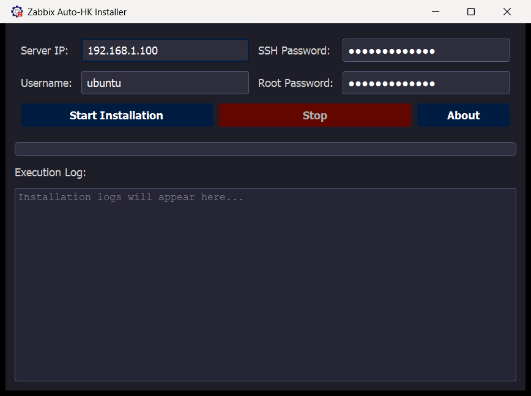
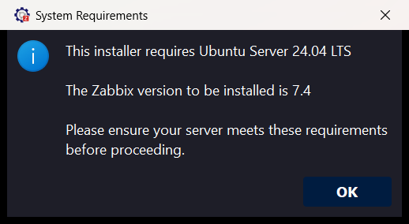

<h1 align="center">Zabbix Auto-HK Installer</h1>

<p align="center"><b>Install Zabbix 7.4 on Ubuntu 24.04 over SSH with one click</b></p>

<p align="center">
  
  
  
  [](https://github.com/alisadhk/zabbix-auto-hk-installer/releases/latest)
</p>

---

## Overview
A PyQt5 wizard that connects to a fresh Ubuntu 24.04 server over SSH (paramiko) and installs Zabbix 7.4 (server, frontend, agent, MySQL database and Apache). A manual step-by-step guide is included in docs/.

## Features
- Automated Zabbix server + frontend installation
- Database creation and DBPassword configuration
- Live execution log with progress bar
- Manual installation guide in the docs folder

## Screenshots
<p align="center"></p>
<p align="center"></p>

## Download and install
### Option A - Ready-to-run download (recommended)
1. Open the **[Releases page](https://github.com/alisadhk/zabbix-auto-hk-installer/releases/latest)**.
2. Download the file(s) listed under **Assets**:

| File | Size |
|---|---|
| `Zabbix-Auto-HK-Installer.exe` | 41.8 MB |

3. Run it. 

### Option B - Run from source
Requirements: Windows 10/11 and Python 3.10+.

```bash
git clone https://github.com/alisadhk/zabbix-auto-hk-installer.git
cd zabbix-auto-hk-installer
python -m pip install -r requirements.txt
python 333.py
```

## How to use
1. Start the program. A **System Requirements** dialog appears first; read it and click **OK**.
2. Enter the **Server IP**, the SSH **Username** and **SSH Password**.
3. Enter the **Root Password** if the server needs it for sudo/root commands.
4. Press **Start Installation** and watch the **Execution Log**.
5. Press **Stop** to abort. When the log shows **Installation Complete**, use the access details printed in the log.

## Configuration and privacy
- All sensitive values from the original private version (passwords, tokens, license codes, user names, internal IP addresses, personal names and links) were replaced with `*****`.

## Build the executable yourself
```bash
python -m pip install pyinstaller
python -m PyInstaller --noconfirm 333.spec
```
The executable is created in the `dist/` folder.

## Notes
- When the installation completes, open http://SERVER-IP/zabbix/ to finish the web setup.
- Run it on Windows 10/11. The target server must be Ubuntu/Debian with SSH enabled.
- The tool needs the server's SSH user and password; use a dedicated account and change the password after installation.

---

<p align="center">Maintained by <a href="https://github.com/alisadhk">@alisadhk</a> - last update 2025-12-23</p>